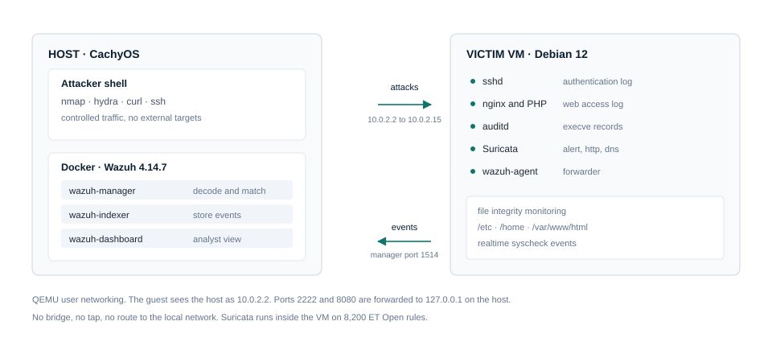

# Wazuh SOC Lab

Six investigations, twelve custom Wazuh rules, one Suricata rule, and a full regression.
A single Debian VM built to practise first-line SOC work: detect, triage, contain or
escalate, then write the ticket the next analyst can act on.

**Last full run**

2026-11-01, all six scenarios replayed under legitimate load. The run
found a real detection gap and fixed it. See [REGRESSION-001](writeups/REGRESSION-001-all-scenarios.md).

| | |
|---|---|
| Role target | SOC Analyst Level 1: monitoring, first-line triage, ticketing, escalation |
| SIEM | Wazuh 4.14.7, single node, Docker |
| Endpoint | Debian 12 VM, Wazuh agent, `auditd`, nginx, `sshd` |
| Network sensor | Suricata 7.0.10, inside the endpoint VM, trimmed ET Open ruleset |
| Attacker | Host shell: `nmap`, `hydra`, `curl`, `ssh` |
| Scope | RFC1918 only, one laptop, no external targets, no real malware |

---

## Start here

Three links, in the order a reviewer should read them.

1. [INC-001, SSH brute force to key persistence](writeups/INC-001/README.md).
   The full package: findings, reproduction, detection and triage guide, attack setup.
   Four documents, Markdown and PDF.
2. [Detection rules for cron and systemd persistence](rules/inc-004-rules.md).
   The detection engineering behind INC-004: rule rationale, test matrix, coverage gaps.
3. [REGRESSION-001, all scenarios under legitimate load](writeups/REGRESSION-001-all-scenarios.md).
   Package installs, PHP deploys, key rotation, and real SSH traffic in the same window.
   It exposed a rule that never fired and documents the fix.

---

## By the numbers

| Investigations | Wazuh rules | Suricata rule | Regressions |
|---|---|---|---|
| 6 | 12 | 1 | 1 |

---

## Architecture



Attacks run from the host over QEMU user networking. The victim VM runs `sshd`, nginx,
`auditd`, Suricata, and the Wazuh agent. The agent forwards authentication logs, `execve`
records, file integrity events, and Suricata alerts to the manager. Full detail is in
[docs/architecture.md](docs/architecture.md).

Every incident was driven from the host shell. No traffic leaves the machine.

---

## Investigations

| ID | Scenario | MITRE | Severity | Outcome |
|---|---|---|---|---|
| [INC-001](writeups/INC-001/README.md) | SSH brute force to `authorized_keys` persistence | T1110, T1078 | High | Key hashed and removed, account disabled, escalation note filed |
| [INC-002](writeups/INC-002/README.md) | Rogue `svc-ops` account added to sudo | T1136.001, T1098, T1548.003 | High | Account and group membership removed, host rechecked |
| [INC-003](writeups/INC-003/README.md) | PHP web shell, command execution as `www-data` | T1505.003, T1059.004 | High | Shell removed, webroot restored, detection added |
| [INC-004](writeups/INC-004/README.md) | Cron and systemd persistence running as root | T1053.003, T1543.002 | Critical | Units and cron file removed, `daemon-reload`, verified |
| [INC-005](writeups/INC-005/README.md) | Outbound SYN sweep, 200 ports in under a second | T1046 | Medium | Recon only, no follow-on activity, threshold boundary documented |
| [INC-006](writeups/INC-006/README.md) | Approved maintenance change tripped the rules | none | Closed | Benign true positive, closed with matching hashes |

Each package contains a findings report, a reproduction guide, a detection and mitigation
guide, and the attack setup. Each incident also has a [ticket](tickets/) with severity,
UTC timeline, SHA-256 evidence, containment, and escalation note.

---

## Detection rules

Custom rules live in [rules/local_rules.xml](rules/local_rules.xml). Each one names the gap
it closes, and each has a test matrix in its paper.

| Rule | Level | Detects |
|---|---|---|
| 100120 | 12 | `authorized_keys` added or modified, possible SSH persistence |
| 100121 | 12 | `usermod` adds a user to a privileged group |
| 100122 | 10 | Interactive SSH login by a service account (`svc-*`) |
| 100123 | 12 | `gpasswd` adds a user to a privileged group |
| 100124 | 12 | `adduser` adds a user to a privileged group |
| 100125 | 12 | New account created directly inside a privileged group |
| 100126 | 12 | `usermod -a -G` adds a user to a privileged group |
| 100127 | 12 | `.php?cmd=` request, possible web shell use |
| 100128 | 12 | PHP file added under a monitored path |
| 100129 | 12 | Cron file added or modified |
| 100130 | 10 | systemd unit or enable link changed |
| 100131 | 12 | Service-account login after the 40112 brute-force correlation |

One Suricata rule, sid 1000001, fires on an outbound SYN sweep above 50 packets in
5 seconds. Rationale and threshold testing are in
[INC-005 rules](rules/inc-005-rules.md).

Rule papers: [INC-002](rules/inc-002-rules.md) ·
[INC-003](rules/inc-003-rules.md) ·
[INC-004](rules/inc-004-rules.md) ·
[INC-005](rules/inc-005-rules.md) ·
[tuning notes](rules/tuning-notes.md).

---

## How a ticket is worked

1. **Validate**  
  Read the raw event, not the rule description. Confirm the log line exists.
2. **Scope**  
  Account, host, source address, first and last event.
3. **Correlate**  
  Join identity, process, file, and network activity on a UTC timeline.
4. **Decide**  
  Contain or escalate, and say which, with the evidence attached.

Every ticket carries the same evidence standard: UTC timeline from the real logs, SHA-256
of any artifact, the alert ID and raw log line, a stated decision, and time to triage.

This is the part I would defend in an interview. A rule that fires is not an incident. The
ticket is the product.

---

## What this lab does not catch

Naming the gaps is part of the work, so they are listed here rather than buried.

- **100127 only matches `cmd` in the first parameter position**  
  A shell called as
  `?x=1&cmd=id` is missed. A broader rule was rejected because it fired on normal pages.
- **100128 matches any `.php` substring**  
  Every deployment, backup, and temp copy alerts.
  Kept for coverage, routed as deployment noise.
- **Package installs produce noise**  
  `100129` fires on `.dpkg-new` staging files, and
  `100130` fires on enable symlinks created by `apt`. Documented, not suppressed.
- **100120 matches by filename**  
  A key written to `authorized_keys.bak` also alerts. The
  exact path is not reachable with the stock FIM decoder and `<match>`.
- **Inbound scanning is not covered**  
  The VM sits behind QEMU user networking, so only
  outbound sweeps are visible. A tap or bridge is noted as future work.
- **Linux only**  
  Windows event mapping is written but not built. See
  [windows-parity.md](windows-parity.md).
- **One host**  
  No AD, no cloud telemetry, no email gateway. Those are the next three
  builds, not claims made here.

---

## Repository map

```
.
├── README.md
├── SCOPE.md                  rules of engagement for the lab
├── windows-parity.md         Windows event IDs mapped to this telemetry
├── docs/
│   ├── architecture.md       components, data flow, constraints
│   ├── architecture.svg      diagram used above
│   ├── build-log.md          command history, including failures
│   ├── build-report.md       readable build narrative
│   └── evidence/             alert JSON, logs, hashes per incident
├── lab/
│   ├── wazuh/                pinned single-node stack setup
│   ├── vm/                   launch, snapshot, and agent provisioning
│   └── suricata/             config notes and local rule
├── rules/                    custom Wazuh rules, per-incident papers
├── runbooks/                 analyst procedures
├── tickets/                  one ticket per incident
└── writeups/                 four-document packages per incident
```

---

## Reproduce it

1. Docker with 4 GB free for the Wazuh stack. The version is pinned at 4.14.7.
2. `lab/vm/launch.sh` builds the Debian 12 VM from cloud-init. `lab/vm/provision-agent.sh`
   enrolls the agent. `lab/vm/snapshot.sh` returns to the clean baseline.
3. Run any attack from `writeups/INC-00x/04-attack-setup.md`, then follow the reproduction
   guide in the same package.

VM images and keys are excluded from the repository. The build log records every command
used, including the ones that failed.

---

## Scope and disclaimer

Independent lab. Not affiliated with any employer. No production, government, or client
data is included, and no findings from authorized assessment work appear here. All
addresses are RFC1918. There is no real malware in the repository, only commands and logs.

Lab rules of engagement: [SCOPE.md](SCOPE.md).